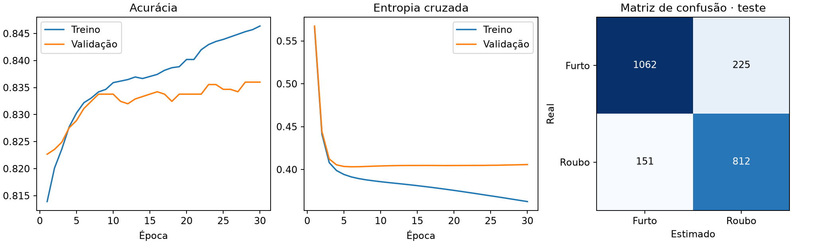

# Classificador de ocorrências de furto e roubo de celular

**Global Solution · Aprendizado Profundo com Redes Neurais Convolucionais· FIAP**  
**Autor:** Matheus Costa Cutrim RM - 568087

O projeto compara três arquiteturas de redes neurais do tipo *Multilayer Perceptron* (MLP) para classificar ocorrências de celulares subtraídos no município de São Paulo em 2024. A rede selecionada usa bairro, período do dia, dia da semana e tipo de local para estimar se a ocorrência informada é compatível com **furto** ou **roubo**.

A arquitetura selecionada atingiu **83,29% de acurácia** e **0,8308 de F1 macro** no conjunto de teste.

**Aplicação online:** <!-- Substitua o texto abaixo pelo link confirmado após a publicação. -->
*https://matheus-ccutrim-cs.github.io/classificador-ocorrencias/*

[Notebook do modelo](GS_MLP.ipynb) · [Relatório técnico](Relatorio_GS_10_slides.pdf) · [Resultados completos](docs/resultados.json)

## Dados e preparação

A base **Celulares subtraídos de 2024** da SSP-SP foi escolhida por reunir registros com natureza da ocorrência e informações de contexto espacial e temporal. O recorte considera o município e a data do fato. [Portal de Consultas da SSP-SP](https://www.portal.ssp.sp.gov.br/estatistica/consultas)

| Etapa | Quantidade |
| --- | ---: |
| Linhas na planilha original | 412.527 |
| Linhas com fatos na capital em 2024 | 221.363 |
| Boletins elegíveis após os filtros | 160.569 |
| Boletins na amostra estratificada | 15.000 |
| Furtos na amostra | 8.579 |
| Roubos na amostra | 6.421 |

A coluna `RUBRICA` define as classes Furto (art. 155) e Roubo (art. 157). A preparação descarta rubricas fora do recorte, boletins com ambos os rótulos e boletins com contextos conflitantes. A chave `ANO_BO + NUM_BO + ID_DELEGACIA` consolida linhas referentes a itens de um mesmo boletim. As categorias ausentes recebem um marcador explícito. O rótulo e os identificadores ficam fora das entradas da rede.

| Entrada | Justificativa |
| --- | --- |
| Bairro | Representa o contexto geográfico dentro da capital. |
| Período do dia | Agrupa as ocorrências em faixas do dia. |
| Dia da semana | Representa padrões semanais e é derivado da data do fato. |
| Tipo de local | Distingue ambientes como via pública e comércio. |

A divisão estratificada, com semente 42, gerou **10.500 registros de treino**, **2.250 de validação** e **2.250 de teste**. O codificador one-hot é ajustado no treino e agrupa categorias com menos de 10 ocorrências nesse conjunto. A representação binária em 0 e 1 dispensa escalonamento adicional.

## Treinamento e resultados

As três MLPs usam ReLU nas camadas ocultas, saída sigmoide, entropia cruzada binária, otimizador Adam, taxa de aprendizado de 0,001 e regularização L2 de 0,001. Cada rede foi treinada por 30 épocas com lotes de 128 exemplos. A comparação mantém essas condições fixas e varia a largura e a profundidade das camadas ocultas.

### Comparação na validação

| Modelo | Neurônios nas camadas ocultas | Acurácia | Precision macro | Recall macro | F1 macro |
| --- | --- | ---: | ---: | ---: | ---: |
| **A** | **32** | **83,60%** | **0,8325** | **0,8377** | **0,8340** |
| B | 64 → 32 | 81,33% | 0,8091 | 0,8111 | 0,8100 |
| C | 128 → 64 → 32 | 81,11% | 0,8070 | 0,8103 | 0,8082 |

A arquitetura A foi selecionada pelo maior F1 macro na validação. A referência que sempre prevê a classe majoritária obteve F1 macro de 0,3639. As redes B e C alcançaram maior acurácia de treino, mas tiveram desempenho inferior na validação.

### Avaliação no teste reservado

| Acurácia | Precision macro | Recall macro | F1 macro |
| ---: | ---: | ---: | ---: |
| **83,29%** | 0,8293 | 0,8342 | **0,8308** |

| Classe real ↓ / Classe estimada → | Furto | Roubo |
| --- | ---: | ---: |
| Furto | 1.062 | 225 |
| Roubo | 151 | 812 |

O erro mais frequente foi classificar furto como roubo. Na arquitetura A, a perda de treino continuou caindo enquanto a de validação se estabilizou e subiu ligeiramente. Na última época, a acurácia de treino ficou 1,04 ponto percentual acima da de validação, indicando sobreajuste leve.



## Estrutura do repositório

| Arquivo ou pasta | Conteúdo |
| --- | --- |
| `modelo.py` | Preparação dos dados, treinamento das três MLPs, avaliação e exportação para a aplicação. |
| `GS_MLP_SP.ipynb` | Exploração dos dados, treinamento e análise dos resultados. |
| `docs/index.html` e `docs/modelo.js` | Interface web e parâmetros exportados da rede selecionada. |
| `docs/resultados.json` e `docs/avaliacao.png` | Métricas, histórico, matriz de confusão e gráficos. |
| `Relatorio_GS_10_slides.pdf` | Relatório técnico com os resultados do projeto. |
| `relatorio.py` e `interface.png` | Gerador do PDF e captura da aplicação usada no slide 9. |
| `requirements.txt` | Dependências do treinamento, notebook e relatório. |

## Como executar

Execute os comandos na raiz do projeto, onde estão `modelo.py` e `requirements.txt`.

### Abrir a aplicação localmente

Com Python instalado e os arquivos `docs/index.html` e `docs/modelo.js` presentes, rode:

```bash
python -m http.server 8000 --bind 127.0.0.1 --directory docs
```

Abra [http://127.0.0.1:8000/](http://127.0.0.1:8000/), selecione os quatro atributos e clique em **Classificar ocorrência**. A página executa a rede diretamente no navegador, usando a codificação one-hot, os pesos e os vieses exportados. Ela exibe a classe estimada e as duas probabilidades. Os valores se referem à classificação da ocorrência informada.

### Reproduzir o treinamento e o notebook

1. No portal da SSP-SP, acesse **Bases de Dados → Celulares subtraídos → 2024**. Baixe a planilha XLSX e salve como `dados/celulares_2024.xlsx` na raiz do projeto. [Portal de Consultas da SSP-SP](https://www.portal.ssp.sp.gov.br/estatistica/consultas)
2. Instale as dependências em um ambiente virtual. Os comandos abaixo são para Windows PowerShell.

   ```powershell
   python -m venv .venv
   .\.venv\Scripts\python.exe -m pip install -r requirements.txt
   ```

   No macOS ou Linux, use `python3 -m venv .venv` e substitua `.\.venv\Scripts\python.exe` por `.venv/bin/python` nos comandos.

3. Execute o treinamento.

   ```powershell
   .\.venv\Scripts\python.exe modelo.py dados/celulares_2024.xlsx --saida docs
   ```

   O comando gera `docs/modelo.js`, `docs/resultados.json` e `docs/avaliacao.png`.

4. Abra o notebook, selecione o kernel do ambiente do projeto, execute todas as células e salve com as saídas.

   ```powershell
   .\.venv\Scripts\python.exe -m jupyterlab GS_MLP_SP.ipynb
   ```

## Limitações e uso de IA generativa

Os dados representam ocorrências registradas e estão sujeitos à subnotificação. Os resultados se aplicam ao recorte de celulares subtraídos na capital em 2024. A divisão aleatória avalia o desempenho dentro desse recorte. As probabilidades da rede não passaram por calibração.

A IA generativa apoiou a implementação, a documentação, os testes técnicos e a análise dos resultados.
